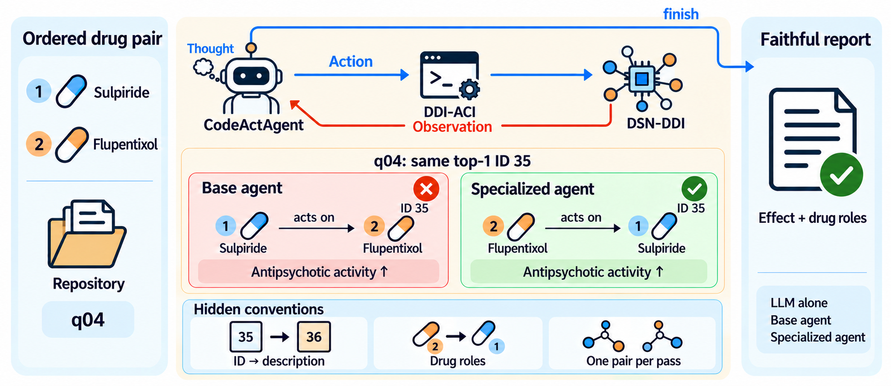

# DDI-ACI

**A Domain-Specific Agent-Computer Interface for LLM Agents Operating a Drug–Drug Interaction Prediction Model**



DDI-ACI is a domain-specific agent-computer interface that specializes OpenHands CodeActAgent for DSN-DDI drug–drug interaction prediction. It supports faithful reporting: preserving the meaning of a model's output. This repository provides tools, runtime images, and evaluation artifacts without changing the LLM, agent, or prediction model.

DDI-ACI encodes three rules:

- **ID mapping**: Map interaction type ID `t` to `Interaction type == t + 1` in SSI-DDI's interaction descriptions, not the `DDI type` column.
- **Drug roles**: Reverse drug roles when `Subject == 2`, which applies to 42 of 86 interaction types.
- **Per-pair scoring**: Score each pair separately because DSN-DDI batching can alter scores.

On ten single-run tasks with Claude Sonnet 5.5, reporting success was 10% / 70% / 100% for LLM alone / base agent / specialized agent.
Both agents matched all top-1 IDs (10/10); the difference arose during reporting and remains statistically inconclusive. [Details](eval_outputs/v2/RESULTS.md)

## Quick start

Requirements: Linux, Docker with NVIDIA GPU support, and Python 3.12 for OpenHands.

```bash
make images
make venv
cp .env.example .env  # Set AI_GATEWAY_API_KEY before continuing.
make try
```

Run from the repository root. `make try` runs the specialized agent by default.

## Documentation

Most internal documentation is in Korean.

- [Results and limitations](eval_outputs/v2/RESULTS.md)
- [Answers side by side](eval_outputs/v2/ANSWER_COMPARISON.md)
- [Evaluation specification](benchmarks/ddi/eval_spec.md)
- [DSN-DDI reproduction](ddi-runtime/REPRODUCTION.md)
- [Tool usage](ddi-tools/microagent/ddi.md)
- [Development rules](.claude/rules/)
- [Agent evaluation and checks](Makefile)
- [Full comparison of all three settings](benchmarks/ddi/eval_spec.md#6-1-실행-명령)

<details><summary>Repository layout</summary>

| Path | Contents |
|---|---|
| `ddi-agent/` | Agent runner: launches OpenHands CodeActAgent for the base agent or specialized agent (`run_agent.py`), config template |
| `ddi-tools/ddi/` | Tool interface the agent calls: the `ddi` Python package imported into the agent's IPython |
| `ddi-tools/server/` | Tool back end: prediction server wrapping the original DSN-DDI model and weights (Python 3.7) |
| `ddi-tools/microagent/` | Micro agent prompt copied into the workspace for the specialized agent: how to use the `ddi` functions |
| `ddi-runtime/` | Runtime images: `ddi-runtime` (base and specialized agents), `ddi-specialist` (specialized agent), reproduction notes |
| `benchmarks/ddi/` | Evaluation: `run_infer.py` (run), `eval_infer.py` (score), `prompts/` (task instruction appended to every query), `data/` (questions, ground truth, relation map), `scripts/` |
| `eval_outputs/` | Run outputs. Published evaluations `v1/` and `v2/` (report, scores, raw runs in `raw/`) are tracked by git; everything else, such as new runs in `eval_outputs/ddi/`, is not |
| `third_party/DSN-DDI/` | Original DSN-DDI repository (submodule) |
| `tests/` | Checks by target: `tools/` (`ddi` package, prediction server; run in containers), `runtime/` (OpenHands runtime), `layout/` (repository layout) |
| `.claude/rules/` | Development rules for this project (overview, layout, tool rules, conditions, evaluation, verification) |

</details>

## Citation

Jun-Hee Kim and Sang-Woong Lee (School of Computing, Gachon University). *DDI-ACI: A Domain-Specific Agent-Computer Interface for LLM Agents Operating a Drug–Drug Interaction Prediction Model*.

## Acknowledgments

Built on DSN-DDI (model and weights), SSI-DDI (interaction descriptions), DrugBank Vocabulary, OpenHands, CodeAct, and SWE-agent.

This work was supported by the National Research Foundation of Korea (NRF) grant funded by the Korea government (MSIT) (RS-2025-00520064).

## License

[MIT License](LICENSE) © 2026 jwhitekim.
